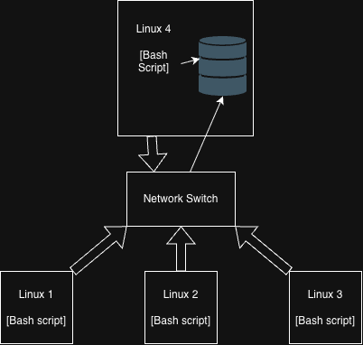

# Linux Cluster Monitoring Agent

## Introduction
This project is a lightweight monitoring tool for a group of Linux servers. A small Bash agent runs on every node. It records the machine's hardware profile once, then takes a snapshot of CPU, memory and disk activity every minute. Each reading is written to a central PostgreSQL database. The users are the infrastructure or operations team that looks after the cluster. They can query the stored history to spot overloaded or failing machines and decide when to add or retire servers. I built the agent with Bash and standard Linux utilities (`lscpu`, `vmstat`, `df`, `hostname`). I used Docker to run PostgreSQL, the `psql` client to load data, and `cron` to schedule collection. Git and GitHub manage the source, and I followed the GitFlow branching model with feature branches, a `develop` branch and release pull requests. The goal was a minimum viable product that works on one machine and scales to a cluster without code changes.

## Quick Start
```bash
# 1. Create and start a PostgreSQL container
./scripts/psql_docker.sh create <db_username> <db_password>
./scripts/psql_docker.sh start

# 2. Create the database (one time) and the tables
psql -h localhost -U <db_username> -W -c "CREATE DATABASE host_agent;"
psql -h localhost -U <db_username> -d host_agent -f sql/ddl.sql

# 3. Record this machine's hardware specs (run once per host)
./scripts/host_info.sh localhost 5432 host_agent <db_username> <db_password>

# 4. Record a usage snapshot (manual test)
./scripts/host_usage.sh localhost 5432 host_agent <db_username> <db_password>

# 5. Collect usage automatically every minute
crontab -e
# add the line below, using the absolute path to your repo:
* * * * * bash /path/to/linux_sql/scripts/host_usage.sh localhost 5432 host_agent <db_username> <db_password> > /tmp/host_usage.log 2>&1
```

## Implementation
I built the project in stages, each on its own feature branch merged into `develop`:
1. Set up a containerized PostgreSQL instance and a script to manage it.
2. Designed two tables, one for static hardware data and one for time-series usage data, and automated their creation in `ddl.sql`.
3. Worked out a single-line command to extract each metric, then wrapped those commands in the two agent scripts.
4. Scheduled the usage script with `cron` and checked that a new row lands every minute.
5. Wrote SQL queries that answer operational questions from the collected data.

### Architecture


Each Linux host runs its own copy of the agent (`host_info.sh` and `host_usage.sh`). Every agent sends its data over the network to one PostgreSQL instance, which runs in a Docker container on one of the nodes. The hosts talk to each other through a switch on the internal network.

### Scripts
**`psql_docker.sh`**: manages the lifecycle of the PostgreSQL container. `create` makes a named volume so data survives container removal, then starts a container on port 5432. `start` and `stop` control an existing container. The script exits with an error if you try to create a container that already exists, if you leave out the credentials, or if you start or stop a container that hasn't been created.
```bash
./scripts/psql_docker.sh create|start|stop [db_username] [db_password]
```

**`host_info.sh`**: reads the machine's hardware details (hostname, CPU count, architecture, model, clock speed, L2 cache, total memory) and inserts one row into `host_info`. Hardware is treated as static, so it runs once per host at install time.
```bash
./scripts/host_info.sh psql_host psql_port db_name psql_user psql_password
```

**`host_usage.sh`**: captures current free memory, CPU idle and kernel percentages, disk I/O and available root disk space. It looks up the host's `id` from `host_info` by hostname and inserts a timestamped row into `host_usage`.
```bash
./scripts/host_usage.sh psql_host psql_port db_name psql_user psql_password
```

**crontab**: runs `host_usage.sh` once a minute so data is collected continuously without anyone having to run it.

**`queries.sql`**: answers questions the operations team asks often:
- **Hardware grouping**: lists hosts by CPU count, ranked by total memory, to show the capacity of each class of machine.
- **Average memory usage**: average used memory as a percentage of total, per host, in 5-minute windows, to show sustained memory pressure.
- **Host failure detection**: flags any host that recorded fewer than three readings in a 5-minute window, which means the agent or the server likely stopped responding.

### Database Modeling
**`host_info`**: one row per server

| Column | Type | Notes |
|---|---|---|
| `id` | SERIAL | Primary key, auto-generated |
| `hostname` | VARCHAR | Fully qualified hostname, unique |
| `cpu_number` | INT2 | Number of CPUs |
| `cpu_architecture` | VARCHAR | e.g. x86_64 |
| `cpu_model` | VARCHAR | CPU model name |
| `cpu_mhz` | FLOAT8 | Clock speed in MHz |
| `l2_cache` | INT4 | L2 cache size in kB |
| `total_mem` | INT4 | Total memory in kB |
| `timestamp` | TIMESTAMP | When the record was taken (UTC) |

**`host_usage`**: one row per host per minute

| Column | Type | Notes |
|---|---|---|
| `timestamp` | TIMESTAMP | Time of the reading (UTC) |
| `host_id` | SERIAL | Foreign key to `host_info.id` |
| `memory_free` | INT4 | Free memory in MB |
| `cpu_idle` | INT2 | CPU idle time, % |
| `cpu_kernel` | INT2 | CPU time in kernel mode, % |
| `disk_io` | INT4 | Disk I/O operations in progress |
| `disk_available` | INT4 | Free space on the root partition, in MB |

## Test
- **DDL**: ran `ddl.sql` against a fresh `host_agent` database and confirmed both tables and their constraints with `\d host_info` and `\d host_usage`. Running it a second time made no changes and raised no errors, because the tables are created only if they don't already exist.
- **`psql_docker.sh`**: tried every branch of the script, including create, a duplicate create, create with missing arguments, start and stop, and an unknown command. Each one gave the expected message and exit code.
- **Agent scripts**: compared each value the scripts collected with the raw command output (`lscpu`, `vmstat`, `df`). Then I ran each script and checked the inserted rows with `SELECT * FROM ...`. I also called the scripts with the wrong number of arguments to confirm they exit with an error.
- **Automation**: let cron run for several minutes and confirmed that `host_usage` got one new row per minute.
- **Debugging**: used `bash -x` to trace variable expansion while building the scripts.

Result: all scripts behaved as expected, and the data in the database matched what the system reported. *(Add any problems you hit and how you fixed them.)*

## Deployment
- **GitHub**: source is version-controlled with GitFlow. Features are developed on `feature/*` branches, merged into `develop`, and released to `main` through a pull request after code review.
- **Docker**: PostgreSQL runs in a container backed by a named volume, so the database is portable and its data persists.
- **crontab**: schedules `host_usage.sh` on each host for continuous, hands-off collection.

## Improvements
1. **Handle hardware changes**: update or version a host's `host_info` row when its hardware changes (for example, added RAM) instead of assuming specs never change.
2. **Secure credentials**: read the database password from a `.pgpass` file or environment variable instead of passing it on the command line, where it shows up in `ps` output and in the crontab.
3. **Retry when the database is down**: buffer readings locally and retry, so a database outage doesn't leave gaps in the data.
4. **Alerting**: run the failure-detection query on a schedule and send a notification (email or Slack) when a host goes silent.
